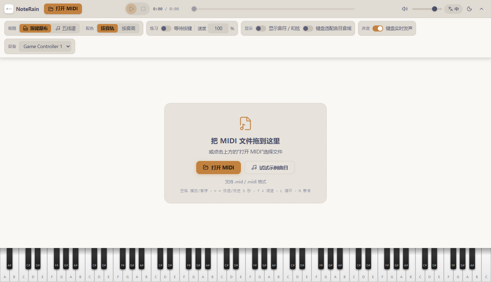
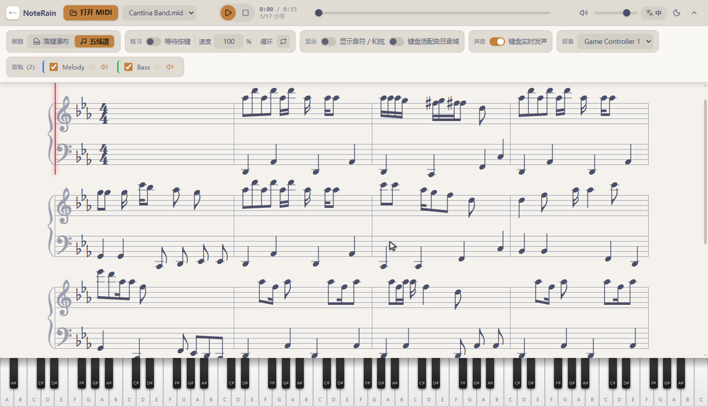
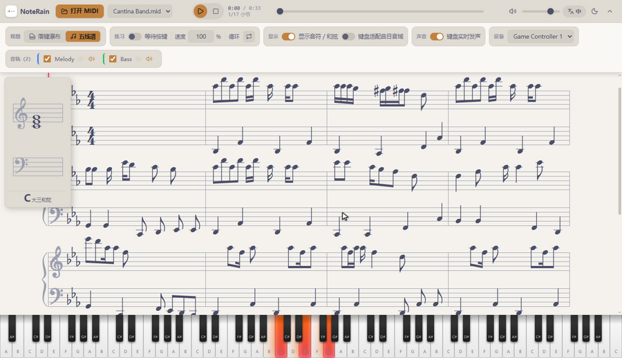

# NoteRain 雨音

<p align="center">
  
</p>

一款现代的 MIDI 播放器 + 钢琴练习软件：落键瀑布（Synthesia 风格）、实时五线谱、88 键虚拟钢琴、MIDI 键盘支持。既可以作为网页运行，也可以打包成 **Windows 独立版 `.exe`**。界面支持 **简体中文 / English** 一键切换。


## 界面截图

| 欢迎页（中文） | 五线谱视图 |
| --- | --- |
|  |  |



## 主要功能

- **播放控制**：播放 / 暂停 / 停止、10%–200% 变速、进度条跳转、小节循环、等待按键（弹对才继续）
- **落键瀑布**：音符下落动画、可调预读时间、音名标注、按键高亮、网格对齐
- **五线谱**：VexFlow 实时排版，自动选择高 / 低音谱号，调号与临时记号、多轨大谱表、播放自动滚动
- **虚拟钢琴**：完整 88 键，鼠标 / 触屏可弹奏，「键盘适配曲目音域」只显示曲目用到的音域
- **音轨管理**：启用 / 禁用、仅显示不发声、单独静音、按音轨配色
- **MIDI 键盘**：WebMIDI 自动识别设备，等待模式练习，实时音符可视化
- **音色**：Salamander Grand Piano 采样，16 个力度层，音量与力度曲线
- **主题**：One Dark（深色）/ Latte（浅色）
- **中文化**：整套界面、提示、和弦名称、加载界面与桌面端菜单均已中文化，首次启动自动跟随系统语言
- **快捷键**：空格播放 / 暂停，方向键跳转、调速，L 循环，M 静音

## 快速开始（源码运行）

需要 Node.js 18+（脚本使用 npm；也可用 Bun 手动执行）。

```bash
# 1. 安装后端依赖
npm install

# 2. 安装前端依赖（前后端分开安装，避免 npm workspace 符号链接问题）
npm --prefix client install

# 3. 启动开发环境（NestJS + Vite）
npm run dev
```

浏览器打开 `http://localhost:5173` 即可。

### 生产模式（网页）

```bash
npm run build       # 构建前后端
npm run start:prod  # 启动，默认 http://localhost:3000
```

## 打包 Windows 独立版 exe

桌面版使用 Electron 封装同一个前端。为了保证 WebMIDI（需要安全上下文）可用，桌面版会在本机回环地址启动一个极小的静态服务器，再加载页面——这也是为什么**不要**图省事改成 `file://` 直接加载。

```bash
# 一次性：安装桌面端依赖（Electron + electron-builder）
npm --prefix desktop install

# 打包：先构建前端，再生成安装包与绿色版
npm run desktop:build
```

产物在 `release/` 目录：

| 文件 | 说明 |
| --- | --- |
| `NoteRain-Setup-<版本>.exe` | NSIS 安装包：按用户安装、可自选目录、创建桌面与开始菜单快捷方式、关联 `.mid` / `.midi` 文件 |
| `NoteRain-Portable-<版本>.exe` | 免安装绿色版：单个 exe，双击即用（首次启动会自解压到临时目录） |
| `win-unpacked/NoteRain.exe` | 未压缩的应用目录，调试 / 二次打包用 |

只想快速看到效果、不生成安装包时：

```bash
npm run desktop:dir          # 只输出 win-unpacked 目录
npm --prefix desktop start   # 直接用 Electron 运行（需先构建前端）
```

### 桌面端专属能力

- 原生菜单：文件（打开 MIDI… `Ctrl+O`）、编辑、视图（缩放 / 开发者工具 / 全屏）、帮助（官网 / 关于）
- 拖拽 `.mid` 文件到窗口即可播放；已在别处运行时会复用同一个窗口
- 支持命令行打开：`NoteRain.exe D:\Music\song.mid`，以及「右键 → 打开方式」
- 窗口尺寸 1360×860 起，内置深色底色，切换浅色主题不闪白

### 常见问题

- **打包时报符号链接错误**：npm workspace 与 electron-builder 都需要符号链接，请把项目放在 NTFS 磁盘上（FAT32 / exFAT 会失败）。本项目已经把前后端依赖拆成两次 `npm install` 来规避该问题。
- **下载 Electron 很慢**：设置镜像后再安装
  ```powershell
  $env:ELECTRON_MIRROR="https://npmmirror.com/mirrors/electron/"
  $env:ELECTRON_BUILDER_BINARIES_MIRROR="https://npmmirror.com/mirrors/electron-builder-binaries/"
  ```
- **改了图标**：编辑 `client/public/logo.png` 后运行 `python desktop/scripts/make-icon.py`，会重新生成 `desktop/build/icon.png` 与 `icon.ico`。

## 快捷键

| 按键 | 功能 |
| --- | --- |
| `空格` | 播放 / 暂停 |
| `←` / `→` | 后退 / 前进 5 秒 |
| `↑` / `↓` | 速度 +5% / -5% |
| `K` | 停止 |
| `L` | 开启 / 关闭小节循环 |
| `M` | 静音 / 取消静音 |
| `Ctrl+O` | 打开 MIDI（桌面版） |

在输入框内输入时不会触发快捷键。

## 使用流程

1. 点击「打开 MIDI」选择文件，或直接把 `.mid` 拖进窗口；空界面里也可以点「试试示例曲目」
2. 用「视图」切换落键瀑布 / 五线谱
3. 有 MIDI 键盘时在「设备」里选择你的设备
4. 打开「等待按键」跟着弹，弹错或漏弹时自动暂停等待
5. 用「循环」框住某几小节反复练习
6. 按空格开始，剩下的交给耳朵

## 技术栈

- 前端：React 19 + TypeScript + Vite
- 可视化：PixiJS（落键）、VexFlow（五线谱）
- 音频：Tone.js + Salamander Grand Piano 采样（16 力度层）
- MIDI：WebMIDI + midi-file
- 状态：Zustand（localStorage 持久化，旧设置自动补齐新字段）
- 后端：NestJS（静态资源 + API）
- 桌面端：Electron + electron-builder（NSIS / portable）

## 目录结构

```
noterain/
├── client/                 # React 前端
│   ├── src/
│   │   ├── components/     # 界面组件（Controls / FallingNotes / SheetMusic / PianoKeyboard）
│   │   ├── hooks/          # 播放、音频、MIDI、快捷键
│   │   ├── i18n/           # 中英文文案与翻译函数
│   │   ├── lib/            # MIDI 解析、钢琴音色引擎、桌面桥接
│   │   ├── stores/         # Zustand 状态
│   │   └── types/          # 类型定义
│   └── public/             # 采样音频、示例曲目、图标
├── desktop/                # Electron 外壳（main / preload / 打包配置）
│   ├── build/              # 应用图标
│   └── scripts/            # 图标生成脚本
├── src/                    # NestJS 后端
├── dist/                   # 构建产物
└── release/                # 桌面端打包产物
```

## 致谢

- 钢琴采样：[Salamander Grand Piano V3](https://sfzinstruments.github.io/pianos/salamander)（Alexander Holm，CC BY 3.0）
- 五线谱渲染：[VexFlow](https://www.vexflow.com/)（MIT）
- 原项目：NoteRain / noterain.app

## 许可

GPL-3.0
