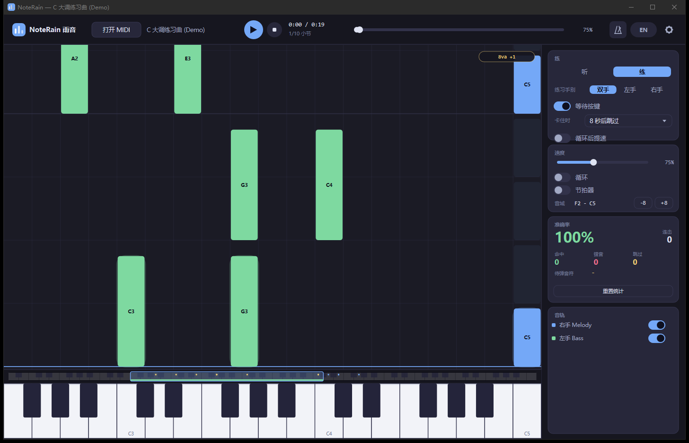
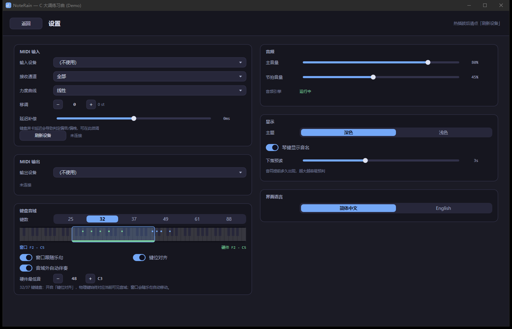
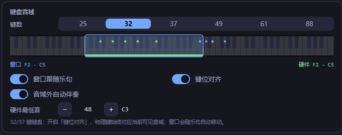

# NoteRain Native 雨音（C++ 原生版）

用 **C++20 全手写** 的钢琴练习器：Direct2D 自绘界面、WASAPI 直接出声、winmm 直接对接 MIDI 设备。
不是网页套壳，也不是 Electron——整个程序是一个 **3.4 MB 的独立 exe**，静态链接，双击即用，不需要任何运行库。

```
build/NoteRain.exe        3.4 MB   （静态链接 MinGW 运行库，无外部依赖）
```

## 界面

练习界面（等待按键：目标音在落键区金色描边，右侧实时统计；琴键上方是全键盘音域总览条）



设置页（MIDI 输入/输出、键盘音域、力度曲线、移调、延迟补偿、音频、显示、语言）



## 为什么是原生

| | 网页版 / Electron | 本项目（C++ 原生） |
| --- | --- | --- |
| 体积 | 100 MB+ | **3.4 MB** |
| MIDI 输入延迟 | 浏览器 WebMIDI，~10–30 ms | **winmm 回调，1–3 ms** |
| 音频路径 | WebAudio → 系统混音 | **48 kHz WASAPI 共享模式，~10 ms 缓冲** |
| 界面 | DOM + CSS | **Direct2D 直接绘制，60 fps** |
| 依赖 | 浏览器内核 | **无** |

## 功能

### 教学模式（核心）

- **等待按键**：弹到目标音之前，播放会停在那个音上，弹对才继续
- **和弦分组**：同一时刻的和弦/双音作为一个整体判定，必须全部按到
- **卡住处理**：一直等 / 8 秒后跳过 / 4 秒后跳过（不会被卡死）
- **分手练习**：双手 / 左手 / 右手（按音高自动区分，另一只手自动伴奏）
- **小节循环**：起止小节可调，循环后可选自动提速（+5%/轮，最多 150%）
- **实时统计**：准确率、连击、命中 / 错音 / 跳过、当前待弹音符、进度小节
- **反馈**：弹对琴键闪绿、错音闪红，待弹音符在落键区有金色描边脉冲

### 播放

- 落键瀑布 + 节拍/小节网格，速度 25%–150%，点击落键区可跳转
- 节拍器（重拍提示音不同），可调音量
- 音轨单独启用/静音，每轨独立配色
- 内置示例练习曲（双手，8 小节，C 大调）

### 小键盘支持（25 / 32 / 37 / 49 键）

硬件只有 32 键，而曲子常常横跨 5–6 个八度。这一套机制让 32 键也能完整练完任何曲子：



| 设置 | 作用 |
| --- | --- |
| **键数** | 25 / 32 / 37 / 49 / 61 / 88，键盘与落键区只显示这么多键 |
| **音域图（可直接拖）** | 整台 A0–C8 的缩略图：蓝框 = 当前 32 键覆盖哪一段，绿条 = 你硬件实际能弹的位置；在图上拖动即可挪窗口 |
| **窗口跟随乐句** | 目标音超出窗口时，窗口按整个八度自动平移过去 |
| **键位对齐** | 把物理键盘的最低键对齐到窗口最低音：窗口一移动，你的 32 个键就自动接管新区间 |
| **硬件最低音** | 你键盘最左边那个键实际发出的音（默认 C3 = 48），用来算出对齐偏移 |
| **音域外自动伴奏** | 窗口装不下的音不再要求你弹，程序自己弹掉，你只练得着的部分 |

**「32 是哪 32 个？」** 图上写得明明白白：蓝框标出的那一段就是，下方还有文字 `窗口 F2 - C5` / `硬件 F2 - C5`。
换键数、拖窗口，这两个标签会同步更新，不会再出现「选了 32 却不知道从哪里开始」。

**演奏时的音域总览条**：主界面的琴键上方常驻一条迷你全键盘（A0–C8），

- 蓝框 = 当前可见的 32 键窗口
- 绿条 = 你硬件真正对应的音域（对齐模式下与蓝框重合，没对齐时错开会变黄，一眼看出没对上）
- 黄/彩色小点 = 接下来要弹的音在当前窗口的哪个位置
- 直接在这条上**拖动**就能整体移动窗口，比按八度键更快

配套的落键区提示：

- 窗口外的音符被压到最左/最右列并降到 22% 透明度，一眼能看出「这个音够不着」
- 落键区左右上角出现 `8vb -1` / `8va +1`，告诉你还差几个八度
- 窗口移动时会强制松开你按住的硬件键，避免卡音

**32 键快速配置**：设置 → 键盘音域 → 键数选 `32` → 打开「键位对齐」→ 硬件最低音设成你键盘最左边的音（多数 32 键控制器是 C3）→ 在音域图上把蓝框拖到合适位置。之后只要有曲子载入，窗口会自动跟着旋律走。

### MIDI / 音频

- **输入设备**热插拔刷新、**接收通道**过滤（全部 / 1–16）
- **力度曲线**：线性 / 柔和 / 硬朗 / 固定力度
- **移调** ±24 半音（演奏移调，显示与判定同步）
- **延迟补偿** ±150 ms：抵消键盘+声卡延迟对判定的影响
- **MIDI 输出**：把演奏和伴奏同时送到外部音源/硬件
- **内置钢琴合成器**：6 个非谐分音 + 逐分音衰减 + 制音器 + 延音踏板，96 音复音
- 音频走 WASAPI 共享模式 48 kHz float32，任何声卡都能用（AUTOCONVERTPCM）

### 界面

- 全中文 / English 一键切换（首次启动跟随系统语言）
- 深色 / 浅色主题，自绘窗口标题栏配色（DWM）
- 设置全部持久化到 `%APPDATA%\NoteRainNative\settings.ini`
- 拖拽 `.mid` 到窗口即可载入；Ctrl+O 打开文件

## 快捷键

| 按键 | 功能 |
| --- | --- |
| `空格` | 播放 / 暂停 |
| `←` / `→` | 后退 / 前进 5 秒 |
| `↑` / `↓` | 速度 ±5% |
| `L` | 循环开关 |
| `M` | 节拍器开关 |
| `W` | 练习模式开关 |
| `[` / `]` | 音域窗口降 / 升八度（32 键键盘用） |
| `S` / `F1` | 设置页 |
| `Esc` | 返回播放界面 |
| `Ctrl+O` | 打开 MIDI |

## 编译

需要 **MinGW-w64 g++ 13+**（推荐 MSYS2 的 `mingw64` 环境）。无第三方库，全部用系统自带的
Direct2D / DirectWrite / WASAPI / winmm。

```bat
:: 最简单
build.bat
:: 产物：build\NoteRain.exe
```

手动命令（等价）：

```bash
windres src/app.rc -O coff -o build/app.res

g++ -std=c++20 -O2 -municode -mwindows \
  -DWIN32_LEAN_AND_MEAN -DNOMINMAX -DUNICODE -D_UNICODE -Isrc \
  src/main.cpp src/app/app.cpp src/app/draw.cpp src/core/smf.cpp \
  src/audio/synth.cpp src/audio/wasapi.cpp src/midi/midiio.cpp \
  src/ui/canvas.cpp src/ui/theme.cpp src/i18n.cpp build/app.res \
  -o build/NoteRain.exe \
  -ld2d1 -ldwrite -lole32 -lwinmm -lcomdlg32 -lshell32 -ldwmapi -luuid \
  -static -static-libgcc -static-libstdc++ -Wl,--subsystem,windows
```

也提供了 `CMakeLists.txt`（`cmake -B build -G Ninja`）。注意：本机 MSYS2 自带的 cmake
启动异常，因此 `build.bat` 是**已验证可用**的路径。

## 代码结构

```
noterain-native/
├── build.bat                 # 一键编译
├── CMakeLists.txt            # 可选 CMake 工程
├── assets/icon.ico           # 应用图标（由脚本生成的 PNG/ICO）
└── src/
    ├── main.cpp              # Win32 窗口、消息循环、拖放、60fps 帧循环
    ├── app/
    │   ├── app.h             # App 状态机：设置、走带、练习引擎
    │   ├── app.cpp           # 设置读写、设备开关、走带、判定、分组逻辑
    │   └── draw.cpp          # 全部界面绘制（顶栏/落键区/键盘/练习面板/设置页）
    ├── core/
    │   ├── song.h            # 曲目模型 + 速度/拍号/小节换算
    │   ├── smf.cpp           # 标准 MIDI 文件解析（format 0/1、running status、tempo map）
    │   └── spsc.h            # 无锁单生产者/单消费者队列
    ├── audio/
    │   ├── synth.h/.cpp      # 加法合成钢琴（分音衰减、制音、延音踏板、节拍器）
    │   ├── engine.h          # 音频输出接口
    │   └── wasapi.cpp        # WASAPI 共享模式事件驱动渲染线程
    ├── midi/
    │   └── midiio.h/.cpp     # winmm MIDI 输入回调 / 输出
    ├── ui/
    │   ├── canvas.h/.cpp     # Direct2D 绘制原语 + 立即模式控件（按钮/开关/滑条/下拉/步进）
    │   └── theme.h/.cpp      # 深色/浅色配色与音轨色板
    └── i18n.h/.cpp           # 中英文文案
```

## 实现要点

- **判定与走带分离**：`time_` 只在没有等待时推进；等待时把它钉在组起点，用户弹对后才放行。
- **分组**：相隔 ≤60 ms 的音算同一组，整组满足才算过；容错按「组」而不是按「单音」。
- **伴奏**：练习时非目标音符（另一只手、其他音轨）照常自动播放，形成伴奏。
- **手感**：力度经曲线映射后送合成器；每个分音独立衰减，高次分音衰减更快、力度越大越亮。
- **延迟补偿**：命中延迟 = 实际等待时长 − 补偿值，写进统计，避免「总是偏早」的错觉。
- **无锁事件**：UI 线程 → 音频线程用 SPSC 队列传递音符事件，音频线程里不分配内存。
- **持久化**：所有设置写 INI；启动自动恢复上次打开的曲目。

## 已知限制

- 只输出到系统**默认播放设备**（没有做设备下拉；WASAPI 枚举接口已经写好，可扩展）
- 没有五线谱渲染（原生版专注落键 + 练习反馈；谱面是网页版的能力）
- 合成器是内置建模钢琴，不是采样音源（想换成 SoundFont 可以替换 `audio/synth.cpp`）
- 只在 Windows 上构建（Direct2D/WASAPI/winmm 均为系统 API）

## 与网页版的关系

仓库里的 `client/`（React + PixiJS）和 `desktop/`（Electron 壳）是原项目；
本目录 `noterain-native/` 是按你的要求**用 C++ 重写的改版**，功能上专注「MIDI 设置 + 教学模式」，
两边互不依赖。

## 致谢

界面配色参考 Catppuccin / One Dark 的深色石板色系；音符落键的交互范式来自 Synthesia。
